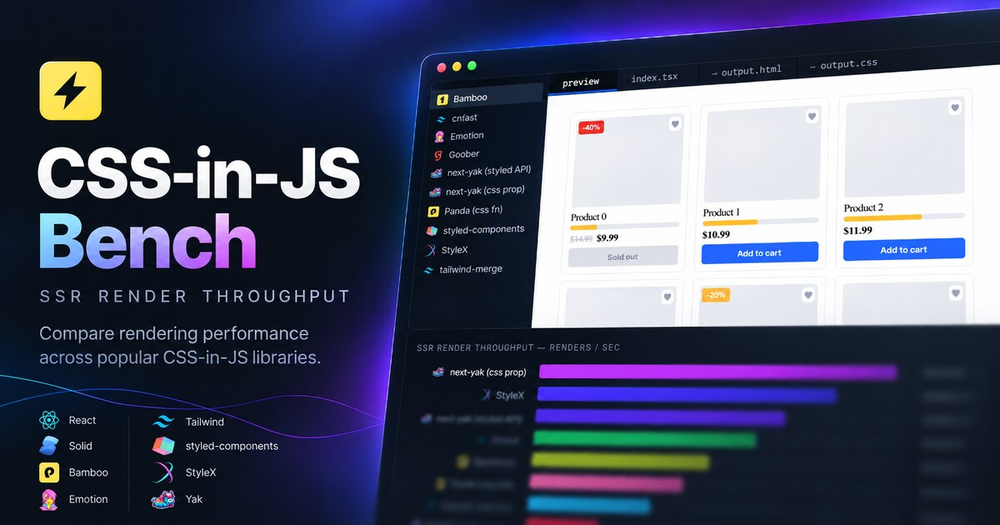

# CSS-in-JS Bench

Renders the same React and Solid components with each styling library and measures
what each one costs at SSR, in the browser and in bytes.

**Live report: <https://jantimon.github.io/css-in-js-bench/>**

## Highlights

Numbers from the run of 2026-11-25 (Node 24, AMD EPYC 9845) for the six lanes in the
report's text summary. CI re-measures, so the live report may show newer values.

- **SSR render throughput, shop page with 400 product tiles:** styled-components renders
  36,756 tiles per second. Bamboo, @yak/react, StyleX and cn render between 114,406 and
  140,429.
- **Where the SSR time goes:** styled-components spends 7.34 ms of a 12.97 ms render in its
  own runtime. The other five lanes spend 0.30 ms or less in their styling library.
- **Page bytes, same page:** from 7,674 B gzipped (@yak/react, css prop) to 29,622 B (cn).
  cn and styled-components each add over 13 kB of gzipped JS to a bare React page.
- **Dynamic values:** with 1,000 unique `translateX` values, styled-components emits a CSS
  rule per value and ships 13,776 B of gzipped CSS. @yak/react compiles the value to a CSS
  variable and ships 97 B. Tailwind and Bamboo cannot take a render-time value in a class,
  so the report measures their inline-style path in a separate case.
- **Browser gaps are smaller:** hydrating the shop page takes 16.48 to 24.06 ms of
  profiled active work across the six lanes.
- **Build time:** a cold client build takes 132 ms with styled-components and 567 ms with
  StyleX.

## What is measured

| Measurement | What it means | Tool |
| --- | --- | --- |
| SSR render throughput | component renders per second in Node, rendering only | tinybench |
| SSR throughput under load | HTTP requests per second, each rendering the full page | autocannon |
| Where the SSR time goes | render CPU split into framework, styling library and components | WPD, Node profile |
| Hydration, interaction, cold mount | browser time to hydrate, update every instance, mount from empty | Playwright, Chrome profile via WPD |
| Browser render work | style recalcs, layout and paint on cold mount | WPD, Chrome and Firefox |
| Page bytes | JS + CSS + HTML, gzipped | gzip |
| Scaling | SSR render time at 100 to 4,000 instances | Node |
| Build time | cold and warm client build per lane | Vite |

Every lane renders the same DOM and the same pixels for a case. `pnpm verify` checks this
before a report is built.

## Lanes

React: @yak/react (styled API and css prop, with and without static folding),
styled-components, Emotion, Goober, StyleX, Panda (css fn, style props, recipe), Bamboo,
Plumeria, Tailwind through `cn` and tailwind-merge, and hand-written CSS as the baseline.
Solid 2: @yak/solid, StyleX, Plumeria, `cn` and hand-written CSS.

## More

- [local-development.md](local-development.md): setup, commands, and how results and CI work
- [Add a lane or a case](local-development.md#add-a-lane): a lane is one folder under `techs/`
- [Live report](https://jantimon.github.io/css-in-js-bench/), also as
  [BENCHMARK.md](https://jantimon.github.io/css-in-js-bench/BENCHMARK.md) and
  [BENCHMARK.json](https://jantimon.github.io/css-in-js-bench/BENCHMARK.json)
